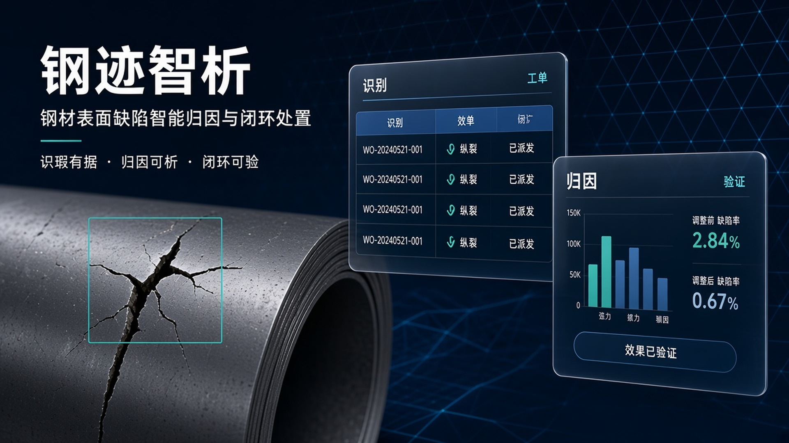
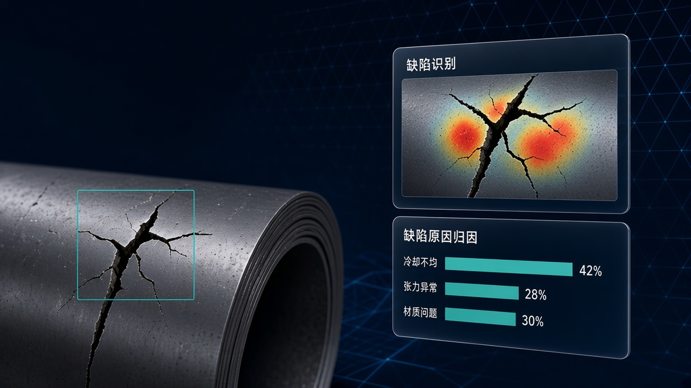
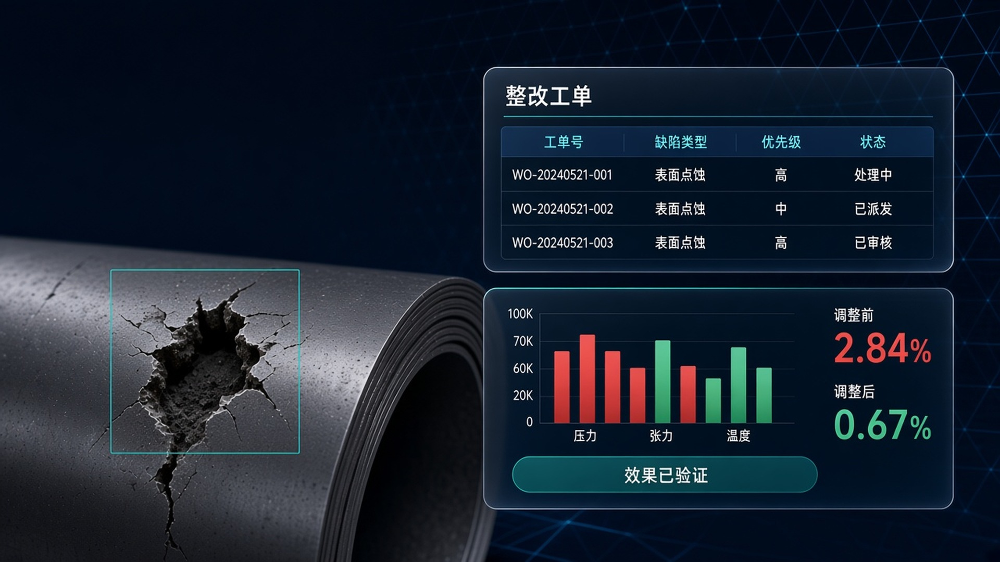
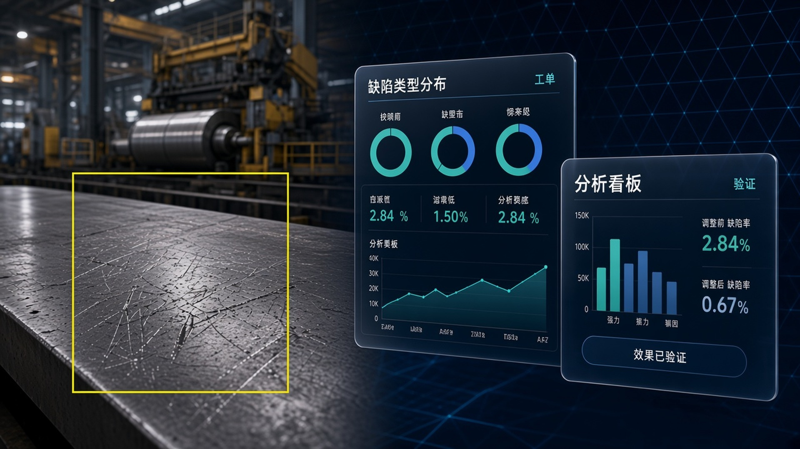

# 钢材表面质量缺陷智能归因与闭环处置平台

面向产线的 **缺陷识别 → 归因诊断 → 整改工单 → 闭环验证** Web 应用（NEU-DET 样件 + 规则知识库 + ONNX 推理）。

**技术栈**：Python 3 · FastAPI · Uvicorn · ONNX Runtime · 原生 HTML/CSS/JS（无前端构建）。

## 产品预览

<p align="center">
  
</p>

<p align="center">
  
  
  
</p>

---

## 快速启动

### Cosmo 平台

使用仓库根目录脚本（**请勿修改**）：

| 脚本 | 说明 |
| --- | --- |
| `start.sh` | `/workspace` 下 `uvicorn app:app`，端口 **8000** |
| `stop.sh` | 释放 8000 端口 |

访问：`http://<主机>:8000/`

### 本地

```bash
pip install -r requirements.txt
python -m uvicorn app:app --host 0.0.0.0 --port 8000
```

可选：`.env.example` → `.env`（Webhook 告警，密钥不进库）。

---

## 仓库结构（根目录仅入口与配置）

```
steel-defect-attribution/
├── app.py              # FastAPI 入口（Cosmo: app:app）
├── start.sh / stop.sh
├── requirements.txt
├── README.md
├── .env.example
├── backend/            # Python 业务与推理
├── data/               # 种子 JSON、样件、模型、运行时库与上传（见 data/README.md）
├── static/             # 生产前端（含 static/brand Logo 与 favicon）
├── resources/          # 素材：展示图、视频、文章、提示词、复现脚本（见 resources/README.md）
└── docs/               # 架构说明、视觉规范
```

| 模块 | 说明 |
| --- | --- |
| 检测工作台 | `data/demo_images` + ONNX `data/model` |
| 归因 / 知识库 | `backend/attribution_engine.py`、`data/knowledge_base.json` |
| 工单与闭环 | `backend/*_service.py`、`data/records.json` |
| 看板 KPI | `data/platform_data.json`（离线评测，接口带 `source` 说明） |

详细分层见 [`docs/ARCHITECTURE.md`](docs/ARCHITECTURE.md)，视觉规范见 [`docs/style_guide.md`](docs/style_guide.md)。

## 复现与素材

数据、模型、提示词、文章配图都在 `resources/`，清单与复现步骤见 [`resources/README.md`](resources/README.md)。

---

## API 节选

| 方法 | 路径 |
| --- | --- |
| GET | `/api/health`、`/api/metrics`、`/api/manifest` |
| POST | `/api/detect`、`/api/detect/upload` |
| POST | `/api/attribute`、`/api/closed-loop/verify` |
| GET | `/api/dashboard`、`/api/work-orders` |
| POST | `/api/qa` |

非 `/api` 路径回退 SPA。示例样件图由 `/demo_images/` 提供（目录 `data/demo_images/`）。

---

## 数据口径

- **实时检测**：上传或点选样件走 ONNX。
- **顶栏 KPI / 看板主图**：`platform_data.json` + `records.json` 离线评测。
- **闭环推演**：按勾选工单与批次重算，预览与保存走 `/api/closed-loop/verify`。

样件与工艺推演为演示数据。© 2026 参赛团队。
