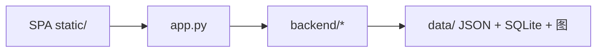

# 架构说明

## 1. 目录职责

```
app.py                 # 唯一 Web 入口；挂载静态路由；组合 backend 服务
backend/
  paths.py             # ROOT、data/ 下各路径（单一事实来源）
  detector.py          # ONNX 检测
  attribution_engine.py
  db.py                # SQLite
  *_service.py         # 归因、闭环、看板、告警、问答等
data/                  # 见 data/README.md
static/                # index.html + app.js + app.css + brand/
docs/                  # 本文与 style_guide.md
```

Cosmo 仅执行 `python3 -m uvicorn app:app`，**不要求**安装包或改 `PYTHONPATH`；`backend` 为普通子包。

## 2. 运行时拓扑



## 3. HTTP 静态挂载

| 前缀 | 目录 |
| --- | --- |
| `/static/` | `static/` |
| `/demo_images/` | `data/demo_images/` |
| `/uploads/` | `data/uploads/` |
| `/annotated/` | `data/annotated/` |

## 4. 配置

- `.env` 在项目根（与 `app.py` 同级），由 `app._load_dotenv()` 加载。
- 数据库：`data/app.db`（首次 `db.init_db` 从 JSON 种子导入）。

## 5. 本地调试

```bash
python -m uvicorn app:app --port 8000
python -m backend.detector crazing_01.jpg   # 可选：模块内自检
```
